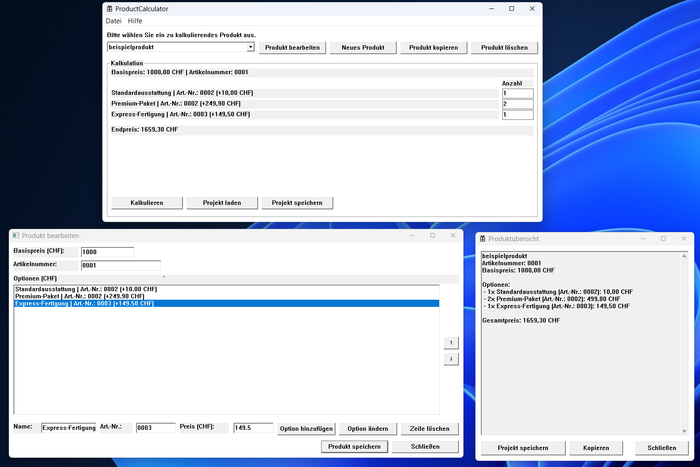

# ProductCalculator

## Überblick
ProductCalculator ist eine Win32-Desktopanwendung zur Konfiguration von Produkten auf Basis von JSON-Dateien und zur dynamischen Berechnung des Endpreises.

## Metadaten
- **Erstellt von:** Patrick Christe
- **Datum:** 01.11.2026
- **Lizenz:** MIT License (siehe [LICENSE.txt](LICENSE.txt))
- **Repository:** [GitHub](https://github.com/Pat-Chr/ProductCalculator)

## Zweck
Die Anwendung unterstützt dabei, schnell passende Produktvarianten zusammenzustellen, Preise transparent zu berechnen und Konfigurationen direkt zu pflegen.

## Screenshot

## Funktionsumfang
- Auswahl vorhandener Produkte aus `productdata/*`
- Dynamische Preisberechnung aus Basispreis + Optionen × Menge
- Bearbeiten von Basispreis und Optionen in eigenem Bearbeitungsfenster
- Anlegen neuer Produkte inkl. Standard-`product.json`
- Löschen bestehender Produkte mit Sicherheitsabfrage
- Ergebnisübersicht in eigenem Fenster mit Kopierfunktion (Clipboard)
- Projekt speichern/laden als `.pcproj` inkl. Mengen und eingebetteter Produktkonfiguration
- Beim Laden wird bevorzugt die im Projekt gespeicherte Konfiguration verwendet (auch für Custom-Optionen)
- Temporär wiederhergestellte Produkte werden beim Beenden automatisch bereinigt
- Währungskonfiguration über `settings.json`

## Typischer Ablauf
1. Produkt im Dropdown auswählen.
2. Mengen je Option eingeben (Startwert je Option: `0`).
3. Endpreis live aktualisiert prüfen.
4. Optional Produkt bearbeiten, neu anlegen oder löschen.
5. Über „Kalkulieren“ die Übersicht öffnen und kopieren.
6. Optional Projekt als `.pcproj` speichern oder wieder laden.

## Datenformat
Produktdaten liegen je Produkt in einem eigenen Ordner:
- `productdata/<productName>/product.json`

Beispielstruktur:
- `productId` (String)
- `productName` (String)
- `basispreis` (Zahl)
- `optionen[]` mit `name` und `preis`

App-Einstellungen:
- `settings.json` → `standardwaehrung` (z. B. `CHF`)

## Technische Hinweise
- Projekttyp: C++ Windows-Desktopanwendung (Win32 API)
- Sprache: C++20
- Oberfläche: Deutsch
- Persistenz: JSON-Dateien (UTF-8)
- Keine externen Framework-Abhängigkeiten erforderlich

## Build und Ausführung
1. Projekt in Visual Studio öffnen.
2. Konfiguration wählen (z. B. `Debug | x64`).
3. Projekt erstellen und starten.

Hinweis:
- Post-Build kopiert `README.md`, `LICENSE.txt`, `settings.json` und den Ordner `productdata` in das Ausgabeverzeichnis.

## Projektstruktur (kurz)
- `ProductCalculator.cpp/.h` – Hauptfenster, Auswahl, Preislogik und Projektaktionen
- `EditProductWindow.cpp/.h` – Produktbearbeitung
- `NewProductCreator.cpp/.h` – Neuanlage von Produkten
- `ProductCopyCreator.cpp/.h` – Produktkopie
- `ProductDeletion.cpp/.h` – Produktlöschung
- `ProductSummaryWindow.cpp` – Ergebnisfenster
- `ProjectPersistence.cpp/.h` – Laden/Speichern von `.pcproj`
- `RestoredProductsCleanup.cpp/.h` – Bereinigung temporärer Wiederherstellungen beim Beenden
- `ProductCalculator.rc` / `Resource.h` – Ressourcen und IDs
- `productdata/` – Produktkatalog
- `settings.json` – Grundeinstellungen
- `ARCHITECTURE.md` – technische Architekturübersicht

## Aktueller Status
- ✅ Produktauswahl und live Preisberechnung
- ✅ Produktbearbeitung mit Synchronisation ins Hauptfenster
- ✅ Neuanlage, Kopie und Löschung von Produkten
- ✅ Ergebnisübersicht mit Clipboard-Kopie
- ✅ Projekt speichern/laden (`.pcproj`) inkl. eingebetteter Produktkonfiguration
- ✅ Bereinigung von `saved_projects/restored_products` beim Programmende
- ✅ Währungssteuerung über Einstellungen

## Dokumentation
- [ARCHITECTURE.md](ARCHITECTURE.md) – detaillierte Architektur
- [CHANGELOG.md](CHANGELOG.md) – Änderungen pro Version
- [productdata/README_Produkte.md](productdata/README_Produkte.md) – Produktdatenstruktur
- [LICENSE.txt](LICENSE.txt) – Lizenz
